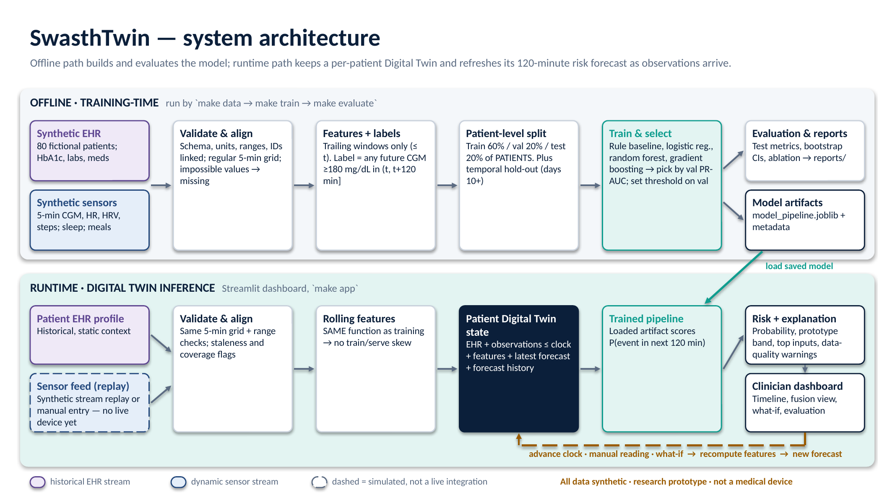

# SwasthTwin — A Personalized Digital Twin for Two-Hour Glucose Risk Forecasting

**Happiest Health Digital Twin Challenge 2026** · Research prototype on **synthetic data** · **Not a medical device**

| Deliverable | Link | Status |
|---|---|---|
| 📊 Presentation (PDF) | [submission/Innovators_IIT_Kharagpur.pdf](submission/Innovators_IIT_Kharagpur.pdf) | ✅ |
| 📊 Presentation (PPT, editable, speaker notes) | [submission/Innovators_IIT_Kharagpur.pptx](submission/Innovators_IIT_Kharagpur.pptx) | ✅ |
| 🧭 Architecture diagram (PDF) | [submission/architecture_diagram.pdf](submission/architecture_diagram.pdf) | ✅ |
| 🧭 Architecture diagram (PPT, editable) | [submission/architecture_diagram.pptx](submission/architecture_diagram.pptx) | ✅ |
| 📝 Demo script (20 min) | [demo/DEMO_SCRIPT.md](demo/DEMO_SCRIPT.md) | ✅ |
| 📈 Evaluation report | [reports/metrics.md](reports/metrics.md) · [metrics.json](reports/metrics.json) | ✅ |
| ⚖️ License | [MIT](LICENSE) | ✅ |

> All files and links must be **publicly accessible without sign-in or extra permissions**: the GitHub repository
> must be public and the YouTube video **Unlisted** (not Private). Check every link in a private/incognito window
> before submitting. See [SUBMISSION_READINESS.md](SUBMISSION_READINESS.md).

---

## Contents

1. [Team details](#1-team-details) · 2. [Project overview](#2-project-overview) · 3. [Problem and motivation](#3-problem-and-motivation) ·
4. [Healthcare use case](#4-healthcare-use-case) · 5. [Proposed solution: what makes it a Digital Twin](#5-proposed-solution-what-makes-it-a-digital-twin) ·
6. [Intended users and workflow](#6-intended-users-and-workflow) · 7. [Data streams and provenance](#7-data-streams-and-provenance) ·
8. [Architecture and data flow](#8-architecture-and-data-flow) · 9. [Technical stack](#9-technical-stack) ·
10. [Feature engineering](#10-feature-engineering) · 11. [AI/ML model and evaluation](#11-aiml-model-and-evaluation) ·
12. [Results and limitations](#12-results-and-limitations) · 13. [Dashboard walkthrough](#13-dashboard-walkthrough) ·
14. [Safety, privacy and responsible use](#14-safety-privacy-and-responsible-use) · 15. [Installation and execution](#15-installation-and-execution) ·
16. [Repository structure](#16-repository-structure) · 17. [Deliverables](#17-deliverables) · 18. [References and acknowledgements](#18-references-and-acknowledgements) ·
19. [License](#19-license) · 20. [Final submission checklist](#20-final-submission-checklist)

---

## 1. Team details

> ⚠️ Incubator, leader email and member details are still placeholders. Edit
> [`config/team_info.yaml`](config/team_info.yaml) **and** this table before submitting.

| Field | Value |
|---|---|
| Team name | Innovators |
| College / University | Indian Institute of Technology Kharagpur |
| Incubator | _TODO: incubator name, or "Not applicable"_ |
| Team leader | Yayavaram Vivekadithya (_TODO: email_) |
| Team members | _TODO: names and roles_ |

## 2. Project overview

**Project title:** SwasthTwin — A Personalized Digital Twin for Two-Hour Glucose Risk Forecasting

SwasthTwin keeps a **per-patient virtual state** that fuses a person's **historical EHR** (HbA1c, diagnosis,
labs, medications) with a **dynamic sensor stream** (CGM, heart rate, HRV, steps, sleep, optional meal log).
Every time new observations arrive, the twin rebuilds its features and asks a trained model:

> **What is the probability that any CGM reading reaches ≥ 180 mg/dL in the next 120 minutes?**

It shows the answer with an explanation, data-quality warnings and a history of how the estimate changed, in a
Streamlit clinician dashboard. Everything runs locally on reproducible synthetic data.

## 3. Problem and motivation

* CGMs produce a reading every five minutes, but the data is mostly reviewed **after** high-glucose episodes.
* The medical record and the wearable stream live in **different systems** and are rarely read together.
* Care teams cannot watch every stream; they need a **short, explained** signal about who may be heading high soon.

We deliberately avoid quoting prevalence or cost statistics we have not verified.

## 4. Healthcare use case

* **Population:** adults living with type 2 diabetes or prediabetes (at risk).
* **Task:** every 30 minutes, estimate `hyperglycemia_event_within_120m` = any CGM reading ≥ 180 mg/dL within
  the next 120 minutes.
* **Target rule:** a configurable prototype rule (`config/model_config.yaml → target`). It is **not** a complete
  clinical definition and must not be used to diagnose anyone.
* **Use:** decision *support* for clinician review — not autonomous alerts, not treatment or dosing advice.

## 5. Proposed solution: what makes it a Digital Twin

A plain classifier scores one row. `PatientTwin` ([`src/swasthtwin/twin.py`](src/swasthtwin/twin.py)) maintains,
for one patient:

1. the historical **EHR profile**;
2. all **sensor observations received up to the twin's clock** (nothing later);
3. **rolling-window features** rebuilt with the *same* function used in training;
4. the **trained pipeline** and its metadata (version, threshold);
5. the **latest forecast** with timestamp, prototype risk band and data-quality warnings;
6. a **history** of every forecast.

The twin is updated by `advance()` (deterministic replay of the synthetic stream), `ingest_observation()`
(manual CGM / HR reading, range-validated) or `log_meal()`. `scenario()` re-scores an **edited copy** of recent
inputs (walk, short sleep, meal, no activity) and leaves the twin unchanged. Every number shown is a real model
call — nothing is a typed-in percentage (verified by `tests/test_model_twin.py`).

**Honest scope:** this is a data-driven twin, not a mechanistic physiology model; the "live" stream is a replay;
what-if results show model sensitivity, not physiological effect.

## 6. Intended users and workflow

Clinician / diabetes educator / researcher: select a patient → see current risk, latest glucose and twin state →
review the timeline → read why the model thinks so → check data-quality warnings → optionally explore what-if
inputs → decide using their own clinical judgement.

## 7. Data streams and provenance

**All data is synthetic**, generated by this repository from seed 2026 — 80 fictional patients × 14 days of
5-minute data. No external dataset is used, so no dataset licence applies.

| Stream | File | Content |
|---|---|---|
| EHR (historical, static) | `data/ehr_patients.csv` | age, sex, BMI, diabetes status/duration, HbA1c, fasting glucose, eGFR, LDL, triglycerides, BP, hypertension, medication class |
| Sensors (dynamic) | `data/sensor_stream.csv.gz` | CGM (mg/dL), heart rate (bpm), HRV RMSSD (ms), steps per 5 min — with gaps |
| Sleep | `data/sleep_log.csv` | nightly duration (h) and quality (0–100) |
| Meal log (optional) | `data/meal_log.csv` | meals the patient chose to log, noisy carb estimates |

The EHR drives the simulator (higher HbA1c/BMI → bigger meal spikes; medication damps them), so the two streams
are genuinely linked. Details, assumptions and known artefacts: [docs/data_provenance.md](docs/data_provenance.md).
Field-by-field units: [docs/data_dictionary.md](docs/data_dictionary.md).

## 8. Architecture and data flow



Offline: synthetic EHR + sensor generation → validation and 5-min alignment → leakage-safe features and
future-window labels → patient-level split → train/select → model artifact + evaluation reports.
Runtime: EHR profile + replayed/manual observations → validation → **same** feature function → patient twin
state → saved pipeline → risk + explanation + warnings → dashboard → clock advance / reading / what-if → refresh.
Module map: [docs/architecture.md](docs/architecture.md).

## 9. Technical stack

| Layer | Tools |
|---|---|
| Language | Python 3.11+ (built and tested on 3.13) |
| Data | pandas, NumPy, SciPy (signal filter in the generator) |
| ML | scikit-learn (pipelines, logistic regression, random forest, histogram gradient boosting, metrics), joblib |
| Dashboard | Streamlit, Plotly |
| Reports | Matplotlib |
| Tests | pytest, Streamlit `AppTest` |
| Deliverables | python-pptx, LibreOffice (PDF export), Playwright (screenshots, optional) |
| Config | YAML (`config/`) |

No paid APIs, cloud services or credentials.

## 10. Feature engineering

42 inputs ([full list](docs/model_card.md#inputs-42-features)), all computed from data with timestamp ≤ the
prediction time, on a regular 5-minute grid with trailing windows:

* **CGM:** latest value, minutes since last reading, 15-min rate of change, 30-min trend, 60/120-min mean,
  60-min SD, 120-min min/max, time in 70–180, data coverage.
* **Wearable:** heart rate (30/120 min), HRV (60 min and relative to the patient's own last 24 h), steps,
  active minutes, wearable coverage.
* **Sleep:** last completed night's duration and quality, hours since waking.
* **Meal log:** carbs logged in the last 120 min, minutes since last log — a meal counts only from the
  moment it is logged.
* **Context:** time of day (sin/cos), weekend.
* **EHR:** all fields above. **Fusion:** latest CGM − EHR fasting glucose; HbA1c × logged carbs.

Missing values are imputed (median + missing indicators); impossible values are treated as missing.

## 11. AI/ML model and evaluation

* **Framework:** scikit-learn `Pipeline` (impute → scale/one-hot → classifier), saved with joblib.
* **Candidates:** no-ML rule baseline (current or 60-min trend-projected CGM ≥ 180), logistic regression,
  random forest, histogram gradient boosting.
* **Selection:** highest PR-AUC on **validation patients** → histogram gradient boosting.
* **Operating threshold:** highest threshold with ≥ 80 % sensitivity on validation patients → 0.858.
* **Splits:** by **patient** (48 train / 16 validation / 16 test, stratified by diabetes status). Extra
  **temporal** check: train on days 0–9 of training patients, test on days 10+ of test patients.
* **Metrics:** ROC-AUC, PR-AUC, Brier, calibration curve, precision, sensitivity, specificity, F1, confusion
  matrix, prevalence; **95 % CIs from a patient-level bootstrap** (300 resamples).
* **Leakage controls:** trailing windows only; meals visible only after logging; labels from future CGM
  computed separately; automated test that features are identical with or without future data.
* **Explainability:** permutation importance (global); single-feature and whole-stream perturbation against a
  typical training patient (local, in the dashboard). Associations, not causes.

## 12. Results and limitations

**Held-out synthetic test patients** (16 patients, 10,275 forecasts, event prevalence 47.6 %). Generated by
`make evaluate`; full report: [reports/metrics.md](reports/metrics.md).

| Model | ROC-AUC | PR-AUC [95 % CI] | Brier | Sensitivity | Specificity |
|---|---:|---:|---:|---:|---:|
| Rule baseline | 0.886 | 0.880 [0.750–0.940] | 0.147 | 0.709 | 0.897 |
| Logistic regression | 0.941 | 0.943 [0.872–0.972] | 0.096 | 0.808 | 0.908 |
| Random forest | 0.969 | 0.970 [0.928–0.986] | 0.073 | 0.825 | 0.963 |
| **Gradient boosting (selected)** | **0.975** | **0.975 [0.939–0.988]** | **0.063** | **0.772** | **0.984** |

* **Harder subset** — glucose not already ≥ 180 (7,151 rows, prevalence 26 %): PR-AUC **0.867** vs 0.472 for the rule.
* **Temporal hold-out** PR-AUC 0.976.
* **Two-stream ablation** (PR-AUC): EHR + time 0.908, sensor + time 0.973, fused 0.975 — the EHR adds little
  overall, a bit more during CGM gaps (0.920 vs 0.905, small subset); intervals overlap.


**Read these numbers with care:**

* They measure agreement with **our own synthetic generator**, not clinical accuracy or benefit.
* Scores are high partly because the simulator is learnable: **time of day is a top feature** because synthetic
  meals follow routines.
* Test sensitivity (77 %) **missed** the 80 % validation target — thresholds did not transfer exactly.
* Only 16 test patients → wide intervals. Probabilities are pushed towards 0/1; bands are uncalibrated.
* No hypoglycemia target, no live device or EHR integration.

## 13. Dashboard walkthrough

| Tab | What it shows |
|---|---|
| Overview | risk card + prototype band, latest CGM, alert threshold, EHR summary, current twin state, risk history |
| Patient timeline | observed CGM with shaded forecast window (no invented values), HR, HRV, steps, sleep, logged meals; optional replay overlay labelled "hidden from model" |
| Two-stream fusion | every model input tagged by stream; probability if each stream were "typical" |
| Prediction & explanation | exact target, probability, top input contributions, plain-language non-prescriptive summary, data-quality warnings |
| Digital Twin simulation | replay the feed, push a manual reading, what-if scenarios, forecast history log |
| Model evaluation | metrics and CIs loaded from `reports/metrics.json`, split method, figures |
| Responsible use | scope, limitations, privacy |

Screenshots (from the running app): [submission/screenshots/](submission/screenshots/).

## 14. Safety, privacy and responsible use

Research and demonstration prototype; **not a medical device**; not validated in real patients; does not
diagnose, make treatment decisions or recommend medication or dose changes. No real personal data; fictional
IDs only; runs offline; no secrets in the repository. Details: [docs/responsible_ai.md](docs/responsible_ai.md),
[docs/model_card.md](docs/model_card.md).

## 15. Installation and execution

Requires Python 3.11+ (tested with 3.13 on Linux) and `make` (optional — the Python commands are shown too).

```bash
git clone <PUBLIC_REPO_URL> && cd swasthtwin
python -m venv .venv && source .venv/bin/activate      # Windows: .venv\Scripts\activate
pip install -r requirements.txt

# The repo already contains generated data, a trained model and reports, so you can start here:
make app                    # = streamlit run app.py   → http://localhost:8501

# Rebuild everything from scratch (≈2 minutes):
make data                   # = PYTHONPATH=src python -m swasthtwin.cli data
make train                  # = PYTHONPATH=src python -m swasthtwin.cli train
make evaluate               # = PYTHONPATH=src python -m swasthtwin.cli evaluate
make test                   # = python -m pytest -q

# Rebuild slides + diagram (needs LibreOffice for PDF export):
make submission
```

On Windows without `make`, set `PYTHONPATH=src` (PowerShell: `$env:PYTHONPATH="src"`) and run the `python -m …` commands.

**Judge smoke test (fresh computer, ~3 minutes):**
1. `pip install -r requirements.txt`
2. `python -m pytest -q` → all tests pass.
3. `streamlit run app.py` → dashboard opens with patient SYN-0002 and a probability card.
4. Click **⏩ +2 h** → clock advances and the risk-history chart gains points.
5. Open **Model evaluation** → table matches [reports/metrics.md](reports/metrics.md).

## 16. Repository structure

```
app.py                      Streamlit dashboard
src/swasthtwin/             data_generator, features, modeling, evaluation, pipeline, explain, twin, charts, cli
config/                     model_config.yaml (all settings), team_info.yaml (team placeholders)
data/                       generated synthetic cohort (committed for instant demo)
artifacts/                  model_pipeline.joblib, model_metadata.json, model_selection.json, patient_split.csv
reports/                    metrics.json, metrics.md, figures/
tests/                      pytest suite (data, leakage, split, model, twin, dashboard)
docs/                       architecture, data dictionary, provenance, model card, responsible AI, design system
submission/                 presentation + architecture (PDF/PPTX), screenshots
demo/                       20-minute demo script and recording checklist
scripts/                    build_architecture.py, build_presentation.py, capture_screenshots.py, check_submission.py
SUBMISSION_READINESS.md     audit checklist
```

## 17. Deliverables

| Required item | Where |
|---|---|
| Team details | [§1](#1-team-details) — team, institution, leader filled; members/email to add |
| College / incubator | [§1](#1-team-details) — IIT Kharagpur; incubator to confirm |
| Project title | [§2](#2-project-overview) |
| Problem statement | [§3](#3-problem-and-motivation) |
| Healthcare use case | [§4](#4-healthcare-use-case) |
| Technical stack | [§9](#9-technical-stack) |
| AI/ML model and framework | [§11](#11-aiml-model-and-evaluation), [model card](docs/model_card.md) |
| 20-minute demo video | **PENDING** — add unlisted YouTube URL here: `<VIDEO_URL>` |
| Open-source license | [§19](#19-license), [LICENSE](LICENSE) |
| Architecture diagram (PDF/PPT) | [PDF](submission/architecture_diagram.pdf) · [PPTX](submission/architecture_diagram.pptx) |
| Presentation (PDF/PPT) | [PDF](submission/Innovators_IIT_Kharagpur.pdf) · [PPTX](submission/Innovators_IIT_Kharagpur.pptx) |
| Public access without permissions | repo must be public; video Unlisted; verify in incognito — see [§20](#20-final-submission-checklist) |

**Video length note:** the challenge text mentions both a *minimum 20-minute* demo and a *15–20 minute* video.
The official rules page could not be read during the build. Confirm the allowed length; the demo script targets ~20:00.

## 18. References and acknowledgements

* ADAG formula for estimated average glucose from HbA1c (eAG = 28.7 × HbA1c − 46.7): Nathan DM et al.,
  *Translating the A1C assay into estimated average glucose values*, Diabetes Care 2008;31(8):1473–1478.
  Used only to set synthetic fasting glucose.
* Open-source libraries: scikit-learn, pandas, NumPy, SciPy, Streamlit, Plotly, Matplotlib, joblib, PyYAML,
  pytest, python-pptx (each under its own open-source licence).
* No third-party code, datasets, fonts or images are copied into this repository.

## 19. License

Source code: **MIT License** — see [LICENSE](LICENSE). The synthetic data, figures and slides are generated by
this code and are released under the same licence. Copyright holder is listed as "SwasthTwin contributors";
the team may replace it with their names.

## 20. Final submission checklist

- [x] Team name, institution, team leader filled
- [ ] Fill incubator, leader email and members in `config/team_info.yaml` and §1, then run `make submission`
- [ ] Record the ~20-minute video (presenter visible) with [demo/DEMO_SCRIPT.md](demo/DEMO_SCRIPT.md)
- [ ] Upload as **Unlisted** on YouTube and paste the URL in the table at the top and in §17
- [ ] Push the repository to GitHub and set it to **Public**
- [ ] Open the repo, PDFs, PPTXs and video in an incognito window — no sign-in required
- [ ] `make test` passes on a fresh clone
- [ ] Run `python scripts/check_submission.py` — no errors
- [ ] Review [SUBMISSION_READINESS.md](SUBMISSION_READINESS.md)
