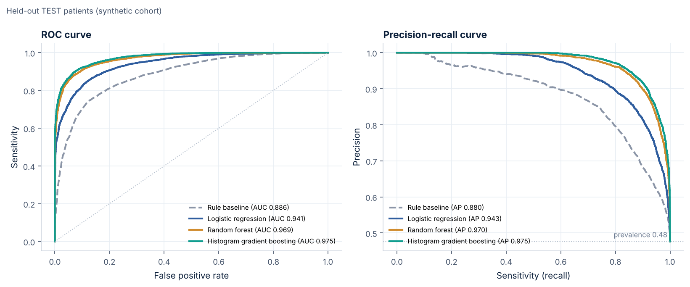
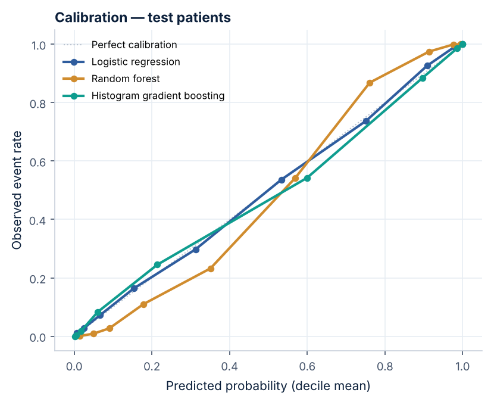
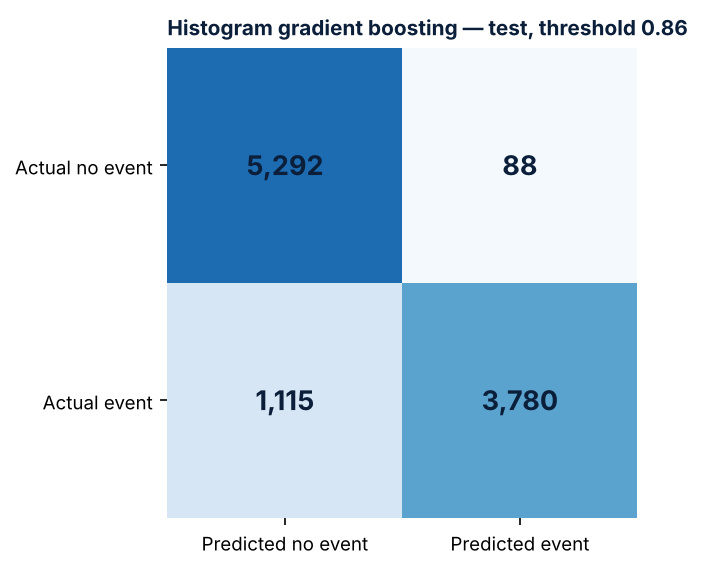
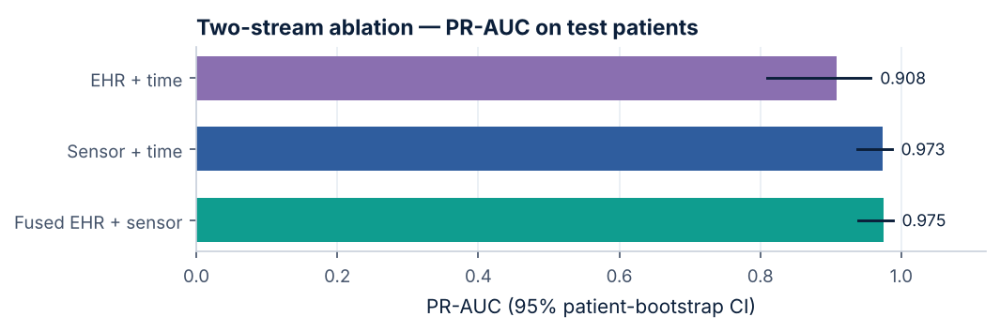
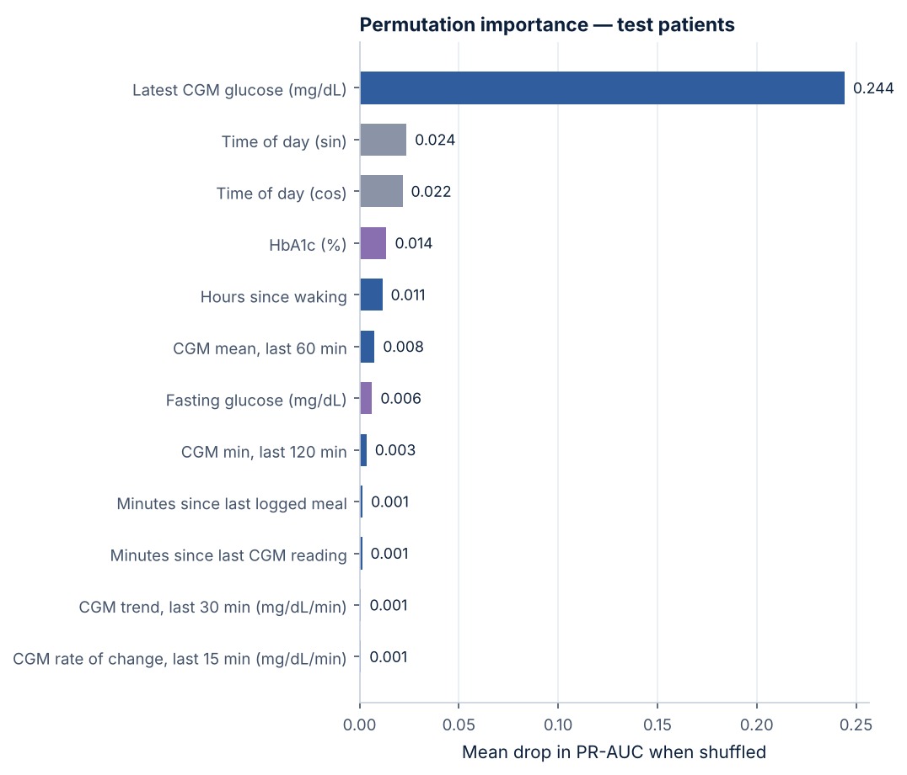

# SwasthTwin — evaluation report

> **Generated automatically by `make evaluate` from `reports/metrics.json`. Do not edit by hand.**
> All numbers measure agreement with a SYNTHETIC data generator. They are not evidence of clinical accuracy or benefit in real patients.

- Target: `hyperglycemia_event_within_120m` — any CGM reading >= 180 mg/dL in the next 120 min (prototype rule, not a clinical definition).
- Model version: `0.1.0+b86039044c2f`; selected model: **Histogram gradient boosting** (chosen on validation patients by PR-AUC).
- Operating threshold: 0.858 (highest threshold reaching sensitivity >= 0.8 on validation patients).
- Split: by patient (no patient in more than one split), stratified by diabetes status; seed 2026.

## Split sizes

| Split | Rows | Patients | Event prevalence |
|---|---:|---:|---:|
| train | 30,898 | 48 | 0.474 |
| val | 10,251 | 16 | 0.482 |
| test | 10,275 | 16 | 0.476 |
| test_onset_subset | 7,151 | 15 | 0.260 |
| test_sensor_gap_subset | 366 | 16 | 0.366 |

## Validation (model selection)

| Model | PR-AUC | ROC-AUC |
|---|---:|---:|
| Logistic regression (baseline ML) | 0.943 | 0.939 |
| Random forest | 0.973 | 0.971 |
| Histogram gradient boosting | 0.977 | 0.976 |

## Held-out test patients (95% patient-bootstrap CI in brackets)

| Model | ROC-AUC | PR-AUC | Brier | Threshold | Sensitivity | Specificity | Precision | F1 |
|---|---:|---:|---:|---:|---:|---:|---:|---:|
| Rule baseline (current or 60-min projected CGM >= threshold) | 0.886 [0.831–0.921] | 0.880 [0.750–0.940] | 0.147 | 0.50 | 0.709 | 0.897 | 0.862 | 0.778 |
| Logistic regression (baseline ML) | 0.941 [0.900–0.967] | 0.943 [0.872–0.972] | 0.096 | 0.57 | 0.808 | 0.908 | 0.889 | 0.847 |
| Random forest | 0.969 [0.947–0.983] | 0.970 [0.928–0.986] | 0.073 | 0.65 | 0.825 | 0.963 | 0.954 | 0.884 |
| Histogram gradient boosting | 0.975 [0.960–0.985] | 0.975 [0.939–0.988] | 0.063 | 0.86 | 0.772 | 0.984 | 0.977 | 0.863 |

Confusion matrix (Histogram gradient boosting, test): TP 3,780 · FP 88 · TN 5,292 · FN 1,115

## Harder subset: test rows where glucose is NOT already >= threshold

| Model | ROC-AUC | PR-AUC | Brier | Threshold | Sensitivity | Specificity | Precision | F1 |
|---|---:|---:|---:|---:|---:|---:|---:|---:|
| Rule baseline (current or 60-min projected CGM >= threshold) | 0.751 | 0.472 | 0.193 | 0.50 | 0.233 | 0.912 | 0.483 | 0.315 |
| Logistic regression (baseline ML) | 0.868 | 0.701 | 0.125 | 0.57 | 0.534 | 0.918 | 0.697 | 0.605 |
| Random forest | 0.931 | 0.843 | 0.095 | 0.65 | 0.544 | 0.976 | 0.888 | 0.675 |
| Histogram gradient boosting | 0.943 | 0.867 | 0.083 | 0.86 | 0.450 | 0.989 | 0.933 | 0.607 |

Paired bootstrap differences (selected model minus comparator, 95% CI):

- hist_gradient_boosting_minus_rule_baseline: PR-AUC [0.048, 0.201], ROC-AUC [0.063, 0.132]
- hist_gradient_boosting_minus_logistic_regression: PR-AUC [0.015, 0.073], ROC-AUC [0.018, 0.062]
- hist_gradient_boosting_minus_random_forest: PR-AUC [0.000, 0.015], ROC-AUC [-0.001, 0.015]

## Temporal hold-out

fit on TRAIN patients, study days 0-9; threshold from VAL patients days 0-9; evaluated on TEST patients, days 10+ (new patients AND later time)

| Model | ROC-AUC | PR-AUC | Sensitivity | Specificity | Rows |
|---|---:|---:|---:|---:|---:|
| Histogram gradient boosting | 0.975 | 0.976 | 0.788 | 0.978 | 2,932 |
| Rule baseline (current or 60-min projected CGM >= threshold) | 0.883 | 0.875 | 0.697 | 0.892 | 2,932 |

## Two-stream ablation (same algorithm, different inputs)

Both single-stream models also receive time-of-day context so the comparison is fair.

| Inputs | Test PR-AUC [95% CI] | Test ROC-AUC | Onset-subset PR-AUC | Sensor-gap-subset PR-AUC |
|---|---:|---:|---:|---:|
| ehr_only | 0.908 [0.810–0.957] | 0.910 | 0.748 | 0.918 |
| sensor_only | 0.973 [0.938–0.986] | 0.973 | 0.858 | 0.905 |
| fused_ehr_plus_sensor | 0.975 [0.939–0.988] | 0.975 | 0.867 | 0.920 |

## Permutation importance (test, top 12)

Predictive association only — not causal.

| Feature | Stream | Mean PR-AUC drop |
|---|---|---:|
| `cgm_current` | Sensor (dynamic) | 0.2442 |
| `hour_sin` | Context (time of day) | 0.0236 |
| `hour_cos` | Context (time of day) | 0.0216 |
| `hba1c_pct` | EHR (historical) | 0.0136 |
| `hours_since_wake` | Sensor (dynamic) | 0.0115 |
| `cgm_mean_60` | Sensor (dynamic) | 0.0076 |
| `fasting_glucose_mg_dl` | EHR (historical) | 0.0063 |
| `cgm_min_120` | Sensor (dynamic) | 0.0035 |
| `minutes_since_meal_log` | Sensor (dynamic) | 0.0015 |
| `cgm_minutes_since_last` | Sensor (dynamic) | 0.0013 |
| `cgm_slope_30` | Sensor (dynamic) | 0.0008 |
| `cgm_roc_15` | Sensor (dynamic) | 0.0007 |

Grouped (whole block shuffled):

- EHR (historical) block: mean PR-AUC drop 0.0420 (sd 0.0012)
- Sensor (dynamic) block: mean PR-AUC drop 0.3748 (sd 0.0059)
- Time-of-day context: mean PR-AUC drop 0.0485 (sd 0.0010)
- Fusion features: mean PR-AUC drop 0.0003 (sd 0.0001)

## Figures

